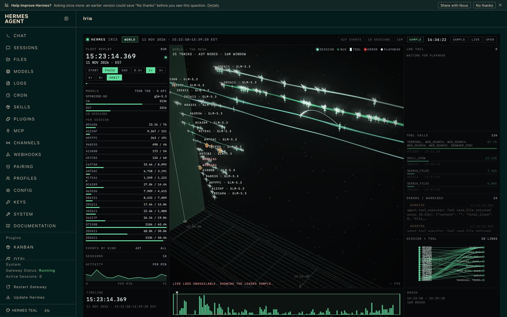

# Iris

Iris turns Hermes sessions and agent logs into a navigable 3D scene: follow an agent's timeline, see delegation hand-offs as links, inspect a failed tool call, and preview the artifact beside its event. The main page works with bundled redacted sample data; live mode reads recent local Hermes activity through the plugin API.

## Features

- 3D session and event map with multi-agent delegation arrows and timeline navigation.
- Live mode with incremental updates; bundled sample fallback when offline.
- Failure highlighting and per-agent token, duration, tool-call, and error metrics (cost is usage, not a guaranteed currency charge).
- Artifact previews for code, JSON, diffs, markdown, images, HTML, and logs; optional locally bundled CodeMirror editor.
- Drop a JSON/JSONL export to explore it without uploading anything.

## Install

After publishing, replace the URL and catalog SHA in this repo:

    hermes plugins install <repo-url>

For local development, try `hermes plugins install ./`; if your Hermes version accepts only catalog/Git identifiers, copy this repository to `$HERMES_HOME/plugins/iris` instead. Then validate:

    hermes plugins validate --install-deps .
    hermes plugins doctor .

The dashboard and Desktop surfaces may require separate enabling in their respective plugin settings.

## Usage

- `/iris` in a Hermes session, or `hermes iris` in a shell, prints the local page and dashboard route; `hermes iris --path` prints just the page path.
- Open the Iris dashboard tab (`/iris`) or the Desktop Iris page. The dashboard-hosted page can call `/api/plugins/iris/live`; a file-opened page uses the bundled sample.
- Choose Live to poll recent redacted events, or drop your own export onto the page.

## Hermes surfaces

Native plugin manifest and Python command registration; dashboard manifest, static tab and FastAPI router; Desktop SDK page, sidebar entry and status pane. No core Hermes files are patched.

## Security & privacy

Iris runs locally. It reads Hermes sessions through `hermes sessions export --redact` and reads bounded local `.log` tails; live mode invokes the redacted export as a subprocess. The plugin does not read credential stores, transmit data to an external service, or use `eval`. The sample export is redacted and scrubbed of personal absolute paths. HTML artifacts are sandboxed. A locally bundled 3D renderer and optional CodeMirror bundle avoid runtime CDN requests. A dropped file remains in the page's memory; inspect it before sharing screenshots.

## Credits

CodeMirror 6, when bundled, is MIT licensed; its license is in `dashboard/vendor/`. Three.js is MIT licensed; its license is alongside the vendored script. Iris 0.1.0 by Arach Tchoupani.
