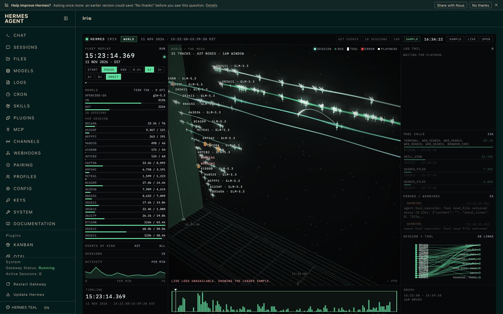

# Iris 0.1.0

Iris presents Hermes sessions, events and agent delegation in a 3D scene with a timeline and artifact inspector. It highlights failures and reports per-agent token usage, duration, tool calls and errors. It includes a redacted sample for an offline demo.

Surfaces: `/iris` command, `hermes iris` CLI, dashboard tab and API, Desktop page/sidebar/pane. No Hermes core patches or privileged tools.

Risk and privacy: live mode invokes `hermes sessions export --redact` as a bounded subprocess and reads bounded local log tails, then redacts response text. No external network calls, credential access, or dynamic code evaluation. User-dropped files are local and can contain sensitive content; the HTML preview is sandboxed. Catalog repo and SHA placeholders must be replaced with the published commit before catalog submission. Desktop activation is separate from Python plugin activation.

Validation note: Hermes 0.23.1's security heuristic flags `inline_shell_exec` in three lines of the minified CodeMirror bundle. Inspection found regex `.exec()` calls, not shell execution; the bundle has no `child_process`, `spawn`, `eval`, or `new Function` call. Validation still passes with this caution.

## Screenshots

- [ ] Add a second image of a failed tool event and artifact preview if useful.
